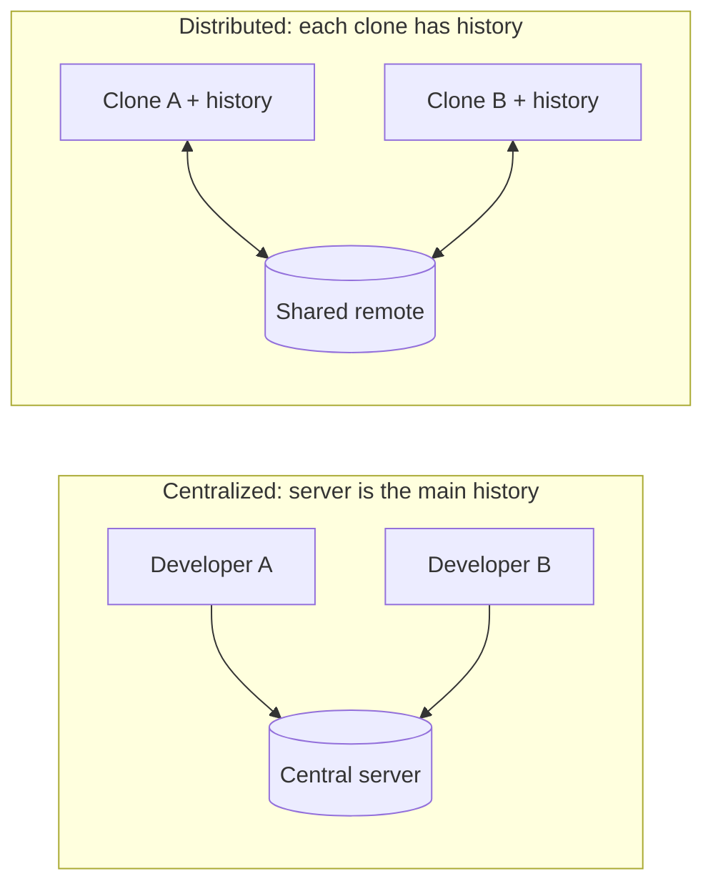
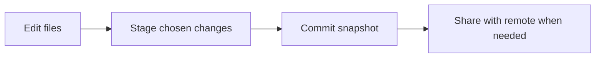

# 00 — Introduction to Version Control

[Home](../README.md) · Next: [01 — Installation & setup](../01-installation-setup/README.md)

## 1. Version control: the plain-language idea

Version control records meaningful snapshots of files so you can inspect what changed, restore an earlier state, and work in parallel without naming copies `final-final-2`. Git is a distributed version-control system (DVCS): every clone contains the project history, so most operations work offline.

Technically, Git stores content-addressed objects and references to snapshots. A commit records a tree (the tracked directory state), parent commit(s), author/committer metadata, timestamp, and message. It does not normally store a full copy of every file per commit; identical content can be reused.

**Analogy:** a project is a shared cookbook. A commit is a dated, labeled edition; a branch is a separate draft path; a merge combines independently edited pages.

### Centralized vs distributed version control



| Model | History location | Offline work | Examples |
|---|---|---|---|
| Centralized VCS | Primarily a server | Often limited | Older SVN-style workflow |
| Distributed VCS | Each clone and shared remotes | Most local operations | Git |

## 2. Git is not GitHub

Git is a command-line tool and data model. GitHub, GitLab, and Bitbucket host Git repositories and add collaboration features such as pull/merge requests, issue tracking, access control, and automation. Git works without any of these services.

| Name | What it is | Typical use |
|---|---|---|
| Git | Distributed version-control software | Commit and compare project history |
| GitHub | Hosted Git service and collaboration platform | Pull requests, Actions, Issues, Pages |
| GitLab | Hosted or self-managed DevOps platform | Git repositories and integrated CI/CD |
| Bitbucket | Atlassian-hosted Git collaboration | Repositories integrated with Jira |

## 3. First command and a minimal workflow

| Command | Purpose | Useful options |
|---|---|---|
| `git --version` | Confirm Git is available | — |
| `git help <command>` | Read command help | `git help commit` |
| `git status` | Summarize current state | `--short`, `--branch` |

```console
$ git --version
git version 2.45.1
```

The version is illustrative; your installed version may differ.



### Walkthrough

1. Make a project folder and enter it: `mkdir hello-git && cd hello-git` (PowerShell accepts the same commands).
2. Initialize version control: `git init -b main`.
3. Check the repository: `git status --short --branch` should show `## No commits yet on main`.
4. Continue to [02 — Git basics](../02-git-basics/README.md) to create the first tracked file and commit.

`git init` creates a hidden `.git` directory. It does not upload files or create a GitHub repository.

## Common misunderstandings

- **“Git is a backup service.”** A local clone protects history from many mistakes, but not disk loss. Push to a trusted remote and maintain backups for important data.
- **“GitHub is required.”** No: local repositories and commits work offline.
- **“A branch is a copied folder.”** A branch is a movable name for a commit; switching updates the working tree.
- **“Every commit duplicates all files.”** Git reuses identical objects and stores snapshots efficiently.

## Pro tips

- Make a repository before building up untracked work; small commits are easier to inspect.
- Use `git status` whenever Git's state is unclear.
- Think of Git as a graph of immutable snapshots, not a sequence of save buttons.

> [!NOTE]
> The terms *remote* and *repository host* are distinct: `origin` is only a conventional local nickname for a remote URL.

## Quick recap

- Version control records changes and makes collaboration/recovery practical.
- Git is distributed; GitHub is one service built around Git.
- A commit is a snapshot with metadata and parent links.

**Previous:** [Course home](../README.md) · **Home:** [Course home](../README.md) · **Next:** [01 — Installation & setup](../01-installation-setup/README.md)
