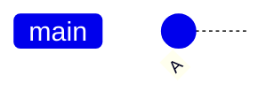
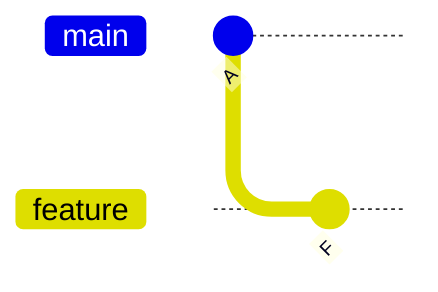
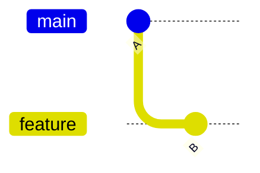
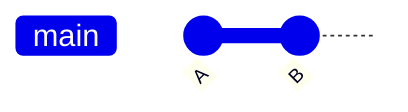
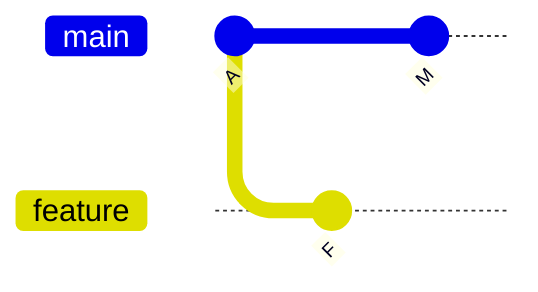
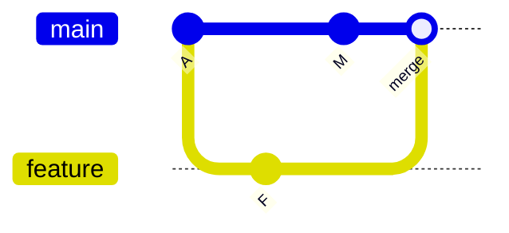

# 04 — Branching and Merging

**Previous:** [03 — Git internals](../03-git-internals/README.md) · **Home:** [Course home](../README.md) · **Next:** [05 — Rebase & history](../05-rebase-and-history/README.md)

## Branches are movable names

A branch lets work progress independently while keeping a shared base. Creating a branch is cheap: it creates a name at a commit; commits made while on it move that name forward.

**Analogy:** a branch is a bookmark in a shared notebook. Two people can continue from the same page; merging reconciles their later work.

| Command | Purpose | Common options |
|---|---|---|
| `git branch` | List/create/delete branches | `-a`, `-d`, `-D` (force delete) |
| `git switch NAME` | Switch branches | `-c NAME` create and switch |
| `git checkout NAME` | Older combined switch/restore command | `-b NAME` create and switch |
| `git merge NAME` | Integrate named branch into current branch | `--no-ff`, `--abort` |
| `git merge-base A B` | Find best common ancestor | — |
| `git log --graph --oneline --all` | Visualize commit graph | `--decorate` |

### A branch creates a parallel line of work

**Before:** one branch points at the latest commit.



**After creating `feature`:** both names initially refer to the same commit; the next feature commit advances only `feature`.



### Branch creation

```bash
git switch -c feature/search
# edit, stage, commit
git switch main
git merge feature/search
```

`git switch` is the modern branch-focused command. `git checkout` remains valid, especially in older scripts, but combines branch switching and file restoration; use `git restore` for file changes and `git switch` for branches to make intent clear.

## Fast-forward merge

When the target branch has not advanced since the feature branched, Git can move the target pointer forward. No merge commit is needed.

**Before**



**After `git switch main && git merge feature`**



## Three-way merge

If both branches have commits after diverging, Git compares their common ancestor and both tips. A successful merge usually creates a new commit with two parents.

**Before**



**After merge**



| Strategy | Result | When useful |
|---|---|---|
| Fast-forward | Move branch pointer; linear graph | Feature is the only line advanced |
| Three-way merge | New commit with both parents | Preserve parallel history and integration point |
| Squash merge | One combined change, usually one parent | Keep target history concise; individual commits not connected as ancestors |

## Resolve a conflict

Conflicts occur when Git cannot automatically combine edits (for example, overlapping lines). Git pauses the merge and marks conflicted paths. The file contains conflict markers such as `<<<<<<<`, `=======`, and `>>>>>>>`.

### Walkthrough: controlled conflict resolution

1. Start from a clean repository and create branches `main` and `feature/heading`.
2. On `main`, edit the same line in `notes.md` to `# Main heading`, then commit.
3. On `feature/heading`, edit that original line to `# Feature heading`, then commit.
4. Switch to `main` and run `git merge feature/heading`; Git reports a conflict.
5. Open `notes.md`, decide the intended final wording, remove all markers, and save.
6. Run `git diff --check`, inspect the file, then `git add notes.md` and `git commit` (or use `git merge --continue` where supported).
7. To cancel before committing, run `git merge --abort`.

Typical status output: `both modified: notes.md`. Always preserve the intended meaning; blindly choosing “ours” or “theirs” can discard valid work.

```console
$ git status --short
UU notes.md
$ git diff --check
# (no output means no whitespace errors)
```

After staging the resolution, status typically shows `M  notes.md`; after completing the merge, `git status -sb` reports a clean working tree.

## Common pitfalls and pro tips

- Merge into the branch you mean to update; `git merge feature` integrates `feature` **into the current branch**.
- Ensure the working tree is clean before switching branches to avoid carrying edits unexpectedly.
- `git branch -d feature` deletes a merged branch; `-D` forcibly deletes it and may discard unmerged commits.
- Prefer small, focused branches and merge them regularly to reduce conflict size.
- After conflict resolution, inspect the complete result and run tests before committing.

> [!WARNING]
> Never remove conflict markers without checking the resulting code. A file can be syntactically valid yet contain the wrong behavior.

## Quick recap

- Branch names move to commits; commits form the history graph.
- Fast-forward moves a pointer; a three-way merge records both histories.
- Resolve conflicts deliberately, stage the resolved files, and verify the result.

**Previous:** [03 — Git internals](../03-git-internals/README.md) · **Home:** [Course home](../README.md) · **Next:** [05 — Rebase & history](../05-rebase-and-history/README.md)
