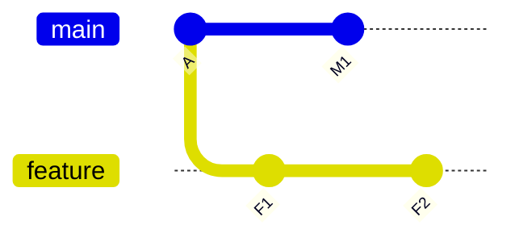
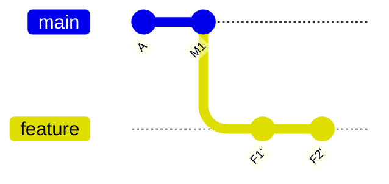

# 05 — Rebase and History Editing

**Previous:** [04 — Branching & merging](../04-branching-merging/README.md) · **Home:** [Course home](../README.md) · **Next:** [06 — Undoing changes](../06-undoing-changes/README.md)

## Rebase: replay commits on a new base

Rebase takes commits from one line of work and replays their changes on top of another commit. It creates new commit IDs because each replayed commit has a new parent. This can make a branch easier to review, but rewriting commits that others already use can disrupt collaborators.

**Analogy:** instead of inserting a new page into the middle of a bound notebook, copy your pages onto the current edition in order. The content may be similar, but the page identifiers (commit IDs) differ.

**Before:**



**After `git switch feature && git rebase main`:**



The apostrophe denotes a new commit, not a modified original.

## Common history tools

| Command | Use | Key options |
|---|---|---|
| `git rebase main` | Replay current branch on `main` | `--continue`, `--abort`, `--skip` |
| `git rebase -i BASE` | Edit/reorder/combine commits after `BASE` | `pick`, `reword`, `edit`, `squash`, `fixup`, `drop` |
| `git cherry-pick COMMIT` | Apply one commit onto current branch | `-x` record source hash; `--continue`, `--abort` |
| `git commit --amend` | Replace latest commit | `--no-edit`, `--reset-author` |
| `git reflog` | Inspect recent local `HEAD`/ref movements | `--date=relative`, `show HEAD@{n}` |

### Interactive rebase walkthrough

Use only on commits that have not been shared, or coordinate with everyone who depends on them.

1. Run `git log --oneline -5` and note the commit just before the series to edit.
2. Run `git rebase -i HEAD~3` to edit the latest three commits.
3. In the todo list, keep `pick` for unchanged commits; use `reword` to change a message or `squash`/`fixup` to combine with the previous commit.
4. Save and close the editor. Resolve any conflicts, `git add` the resolved paths, then `git rebase --continue`.
5. Inspect `git log --oneline --graph` and test the result. Use `git rebase --abort` to return to the pre-rebase state if the operation goes wrong.

## Squash, amend, and cherry-pick

- **Squash:** combine several related commits, often during interactive rebase or by using a host's squash-merge option.
- **Amend:** replace the latest commit, e.g. `git commit --amend -m "fix: correct title"`. This rewrites its ID.
- **Cherry-pick:** apply a particular change to another branch, e.g. `git switch release/1.x; git cherry-pick abc1234`. It creates a new commit; cherry-picking a merge commit requires choosing a mainline parent with `-m`.

## Rebase vs merge

| Property | Merge | Rebase |
|---|---|---|
| Preserves original branch commits | Yes | Replays into new commits |
| Graph | May show parallel lines and merge commit | Often linear |
| Good for | Shared branches, explicit integration history | Updating private feature branch |
| Main hazard | Unwanted merge direction/conflicts | Rewriting shared history |

## Reflog: recovery through local movement history

```console
$ git reflog --oneline
9abc123 HEAD@{0}: reset: moving to HEAD~1
1def456 HEAD@{1}: commit: add useful example
...
```

If a commit seems lost, identify its hash from `git reflog`, inspect it with `git show HASH`, then protect it: `git branch rescue/name HASH`. Reflog entries expire and are local; do not wait to recover important work.

> [!WARNING]
> Avoid rebasing commits that have already been pushed and used by others. Do not use `git push --force` to “fix” rewritten shared history; coordinate, and when a force update is truly necessary prefer `--force-with-lease` after checking remote changes.

## Pitfalls and recap

- A rebase conflict may happen once per replayed commit; resolve and continue, or abort.
- `git rebase --skip` drops the current commit's patch—use only when that patch is intentionally unnecessary.
- `git commit --amend` changes the latest commit, not the whole branch.
- Reflog is a recovery aid, not permanent backup.

**Quick recap:** rebase makes new commits on a different base; merge preserves both histories; amend/cherry-pick also create replacement or copied history. Inspect the graph afterward.

**Previous:** [04 — Branching & merging](../04-branching-merging/README.md) · **Home:** [Course home](../README.md) · **Next:** [06 — Undoing changes](../06-undoing-changes/README.md)
