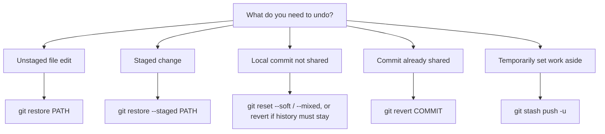
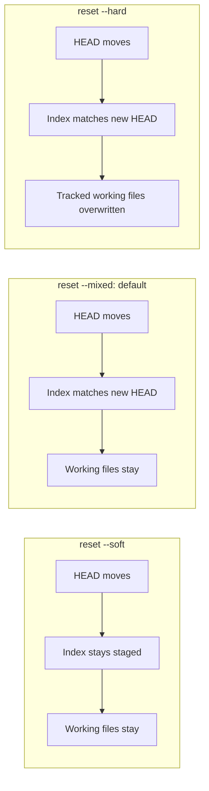

# 06 — Undoing Changes Safely

**Previous:** [05 — Rebase & history](../05-rebase-and-history/README.md) · **Home:** [Course home](../README.md) · **Next:** [07 — Remote repositories](../07-remote-repositories/README.md)

## Choose by what you want to undo

Git offers different tools for edits in the working tree, staged changes, local commits, and shared commits. First inspect `git status` and `git log`; then choose the narrowest command.

**Analogy:** `restore` edits the current draft, `reset` moves your private bookmark, `revert` adds a correction page to the shared record, and `stash` puts unfinished pages in a temporary drawer.



## Command reference

| Command | Changes | Safety / common options |
|---|---|---|
| `git restore PATH` | Replace working file from index | `--source=COMMIT`; discards unstaged content in path |
| `git restore --staged PATH` | Unstage file, keep working changes | Modern alternative to `git reset PATH` |
| `git reset --soft COMMIT` | Move current branch; keep index and files | Commit(s) become uncommitted but staged |
| `git reset --mixed COMMIT` | Move branch; reset index, keep files | Default reset mode |
| `git reset --hard COMMIT` | Move branch, reset index and tracked files | Destructive; local changes may be lost |
| `git revert COMMIT` | Add a new commit that reverses a change | Safe for shared history; may conflict |
| `git clean -n` | Preview removal of untracked files | `-fd` removes untracked files/directories; destructive |
| `git stash push -m "message"` | Save tracked changes temporarily | `-u` also includes untracked files |
| `git stash list / pop / apply` | Inspect/reapply saved work | `pop` removes stash if applied; `apply` retains it |

### Reset comparison



| Choose | Index | Working directory | Typical use |
|---|---|---|---|
| `--soft` | Preserved | Preserved | Recombine latest commits |
| `--mixed` | Reset to target | Preserved | Uncommit, then selectively stage |
| `--hard` | Reset to target | Reset to target | Discard tracked local changes intentionally |

### Safe walkthrough: unstage, then undo

1. Edit `README.md`, then `git add README.md`.
2. Inspect `git diff --staged`.
3. To unstage but keep the edit, run `git restore --staged README.md`; verify `git status` shows ` M README.md`.
4. To discard the edit, first make sure it is not needed, then run `git restore README.md`; verify the file content and `git status`.
5. For a commit already pushed/shared, use `git revert HASH`, inspect the new diff, and push the new commit.

Representative output after unstaging a modified tracked file:

```console
$ git status --short
 M README.md
$ git restore README.md
$ git status --short
# no output: working tree is clean
```

## Comparison: reset vs revert vs restore

| Tool | Primary target | Rewrites branch history? | Shared-history friendly? |
|---|---|---:|---:|
| `restore` | File content/index | No | Yes (local files only) |
| `reset` | Current branch pointer and optionally index/files | Yes | Usually no for published commits |
| `revert` | A commit's effect | No; adds commit | Yes |

## Common pitfalls

- `git restore` can permanently discard uncommitted content in the selected path.
- `git reset --hard` resets tracked files; it does not delete untracked files (that is what `git clean` affects).
- `git clean -fd` can delete untracked work. Preview first with `git clean -nd`; consider `-n` before every clean.
- `git stash pop` can conflict; resolve files as usual. Use `git stash apply` if you want to keep a backup entry until verified.
- Reverting a merge commit needs a chosen mainline parent (`git revert -m 1 MERGE_COMMIT`). Understand the parent before proceeding.

> [!WARNING]
> Before any destructive command, inspect `git status`, save important edits elsewhere, and confirm the target. Prefer `revert` for already-shared commits.

## Quick recap

- Restore edits files; reset moves your branch and optionally resets staged/working state; revert records an inverse commit.
- Stash is temporary storage, not long-term history.
- Preview destructive cleanup and preserve a recovery point when uncertain.

**Previous:** [05 — Rebase & history](../05-rebase-and-history/README.md) · **Home:** [Course home](../README.md) · **Next:** [07 — Remote repositories](../07-remote-repositories/README.md)
