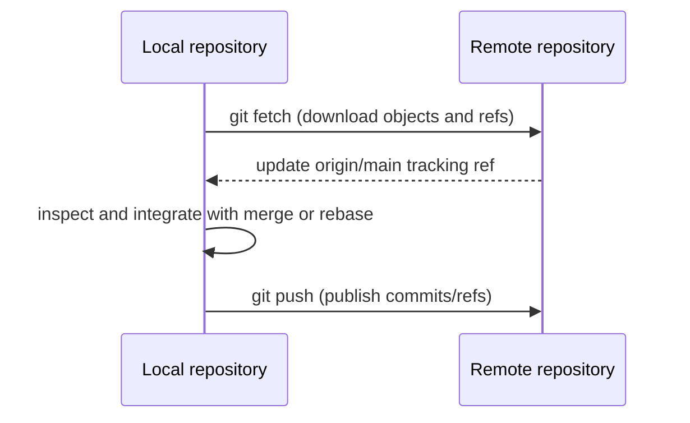

# 07 — Remote Repositories

**Previous:** [06 — Undoing changes](../06-undoing-changes/README.md) · **Home:** [Course home](../README.md) · **Next:** [08 — GitHub essentials](../08-github-essentials/README.md)

## Local and remote repositories

A remote is a named URL to another repository. It commonly lives on a host such as GitHub, but can also be another server or local path. Fetch transfers objects and updates remote-tracking refs; pull fetches and then integrates; push publishes commits and refs.

**Analogy:** fetch checks the team's noticeboard and copies the updates to your desk; pull also folds the chosen updates into your draft; push submits your completed work.



## Commands and options

| Command | Purpose | Common options |
|---|---|---|
| `git remote -v` | List remote names and URLs | `add`, `set-url`, `remove` |
| `git fetch origin` | Download remote updates | `--prune`, `--tags` |
| `git pull` | Fetch and integrate current upstream | `--rebase`, `--ff-only` |
| `git push origin BRANCH` | Publish branch | `-u` set upstream; `--tags`; `--force-with-lease` carefully |
| `git branch -vv` | Show upstream tracking | — |
| `git tag -a v1.2.0 -m "..."` | Create annotated version tag | `git push origin v1.2.0` to publish it |

## Walkthrough: connect and publish

1. Create an empty hosted repository named `recipe-notes`.
2. In your local repository: `git remote add origin https://github.com/OWNER/recipe-notes.git`.
3. Verify with `git remote -v`.
4. Publish and set tracking: `git push -u origin main`.
5. Later, run `git fetch origin`, inspect `git log --oneline --graph --all`, integrate intentionally, and push your branch.

Expected tracking output includes `branch 'main' set up to track 'origin/main'`. Use an SSH URL instead if SSH authentication is configured.

## Fetch vs pull

| | `git fetch` | `git pull` |
|---|---|---|
| Downloads objects | Yes | Yes |
| Integrates into current branch | No | Yes (merge or rebase according to options/config) |
| Lets you inspect first | Yes | Less directly |
| Recommended when | You want explicit review | You are ready to update current branch |

For an explicit, predictable update: `git fetch origin` followed by `git log ..origin/main` and either `git merge origin/main` or `git rebase origin/main` as appropriate.

## Upstream branches, tags, and releases

An upstream is the remote branch a local branch tracks. `git push -u origin feature/name` sets it; afterward `git pull` and `git push` can infer the target. A Git tag marks a point in history; a GitHub Release is a host-side presentation around a tag, notes, and optional downloadable assets.

```bash
git tag -a v1.0.0 -m "Release 1.0.0"
git push origin v1.0.0
git ls-remote --tags origin
```

## Common errors and tips

- **No upstream configured:** use `git push -u origin BRANCH` once.
- **Non-fast-forward push rejected:** fetch first, inspect remote work, integrate, then push. Do not blindly force push.
- **Wrong URL:** inspect `git remote -v`; correct with `git remote set-url origin URL`.
- **Accidental force update:** prefer `git push --force-with-lease`, which refuses if the remote ref differs from the version you observed. It can still overwrite others' work; coordinate first.
- **Remote branch deleted but still listed:** `git fetch --prune` removes stale remote-tracking refs.

> [!IMPORTANT]
> A successful push shares commits, including accidental secrets in their history. Revoke exposed credentials first; history cleanup alone does not invalidate a secret.

## Quick recap

- `fetch` downloads; `pull` downloads and integrates; `push` publishes.
- Upstream tracking makes common commands shorter.
- Tags identify releases; publish tags explicitly and create host releases when useful.

**Previous:** [06 — Undoing changes](../06-undoing-changes/README.md) · **Home:** [Course home](../README.md) · **Next:** [08 — GitHub essentials](../08-github-essentials/README.md)
