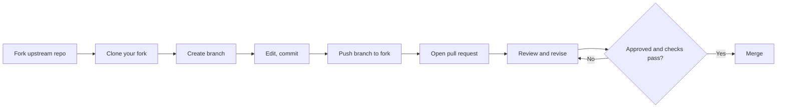

# 08 — GitHub Essentials

**Previous:** [07 — Remote repositories](../07-remote-repositories/README.md) · **Home:** [Course home](../README.md) · **Next:** [09 — Collaboration workflows](../09-collaboration-workflows/README.md)

## What GitHub adds to Git

GitHub hosts Git repositories and provides identity, permissions, pull requests, issues, reviews, automation, project boards, and release pages. The underlying commits and branches remain Git data; host features coordinate people around them.

**Analogy:** Git is the shared document's revision history; GitHub is the library, discussion desk, review process, and access system around it.

### Fork-to-merge collaboration flow



## Core features

| Feature | Problem solved | Use it for |
|---|---|---|
| Repository | Central home for code/docs and history | Project source and settings |
| Fork | Personal server-side copy | Contributing without direct write permission |
| Pull request (PR) | Proposed branch integration and discussion | Review, checks, and merge |
| Issue | Track bug, question, or planned work | Reproducible requests and coordination |
| Code review | Inspect proposed diff and leave comments | Quality, correctness, knowledge sharing |
| Projects | Table/board/roadmap across issues and PRs | Team planning |
| README | Entry point and usage guide | Explain purpose, setup, and contribution |
| License | State permissions and conditions | Clarify reuse rights |

| Command | Use |
|---|---|
| `git clone URL` | Download a local working copy |
| `git remote add upstream URL` | Name the source project when working from a fork |
| `git switch -c BRANCH` | Create an isolated contribution branch |
| `git push -u origin BRANCH` | Publish the branch to your fork and set tracking |
| `gh pr create` | Open a PR from the terminal with GitHub CLI installed |

Typical `gh pr create` output includes a URL for the new pull request. The browser workflow is equally valid; GitHub CLI is optional.

## Fork vs clone

| | Fork | Clone |
|---|---|---|
| Where it lives | Hosted account/organization | Local computer |
| Makes a separate hosted copy | Yes | No |
| Copies files/history locally | Not by itself | Yes |
| Typical open-source sequence | Fork first if needed | Clone your fork afterward |

## Walkthrough: contribute with a pull request

```bash
git clone https://github.com/YOU/PROJECT.git
cd PROJECT
git remote add upstream https://github.com/UPSTREAM/PROJECT.git
git switch -c docs/fix-install-guide
# edit and verify files
git add README.md
git commit -m "docs: clarify installation steps"
git push -u origin docs/fix-install-guide
```

Open a PR from your branch to the upstream repository's default branch. Describe the problem and solution, link related issues, note tests, and respond to review. If upstream advances, use `git fetch upstream` and integrate deliberately. Avoid changing the PR's target branch without understanding the project's contribution policy.

```console
$ git remote -v
origin    https://github.com/YOU/PROJECT.git (fetch)
origin    https://github.com/YOU/PROJECT.git (push)
upstream  https://github.com/UPSTREAM/PROJECT.git (fetch)
upstream  https://github.com/UPSTREAM/PROJECT.git (push)
```

If you do not have push permission to upstream, push only to `origin` (your fork).

## Issues, reviews, README, and licenses

- File an issue with a clear title, expected/actual behavior, minimal reproduction, environment, and logs with secrets removed.
- In review, focus on correctness, maintainability, security, and scope. Be specific and kind; distinguish a blocker from a suggestion.
- A useful README answers: what is this, why use it, how to install/run, examples, support, and how to contribute.
- Choose a license intentionally. MIT is permissive and requires retaining notice/disclaimer; it is not a substitute for legal advice. Without an explicit license, others do not automatically receive broad reuse permission.

## Common pitfalls and pro tips

- A PR is a proposal, not a special kind of commit. It compares branches and hosts discussion/checks.
- Keep PRs small and focused; include screenshots for visual changes and tests for behavior changes.
- Do not paste credentials, personal information, or unredacted logs in issues.
- Mention an issue with `Fixes #123` in the PR/commit description when appropriate; GitHub may close it on merge to the default branch.
- Protect the default branch and require checks/review for important shared projects.

> [!TIP]
> A high-quality PR summary states **why**, **what changed**, and **how it was verified**.

## Quick recap

- Git handles snapshots and history; GitHub hosts projects and collaboration workflows.
- Fork creates a hosted copy; clone creates a local copy.
- PRs combine diffs, discussion, checks, review, and a proposed integration.

**Previous:** [07 — Remote repositories](../07-remote-repositories/README.md) · **Home:** [Course home](../README.md) · **Next:** [09 — Collaboration workflows](../09-collaboration-workflows/README.md)
