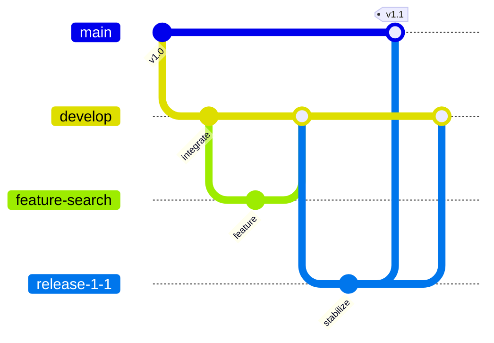
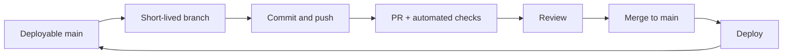
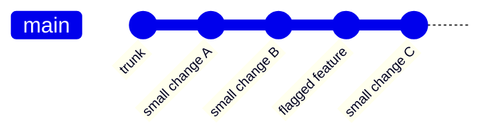
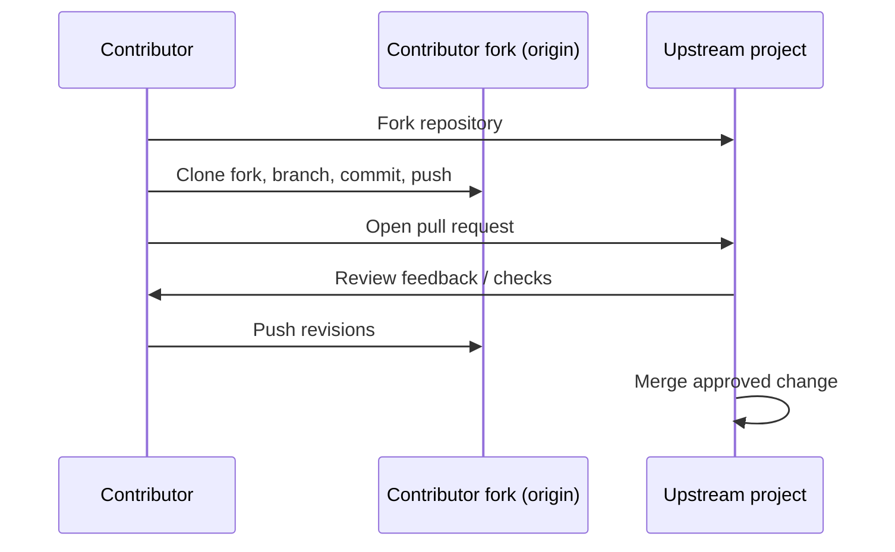

# 09 — Collaboration Workflows

**Previous:** [08 — GitHub essentials](../08-github-essentials/README.md) · **Home:** [Course home](../README.md) · **Next:** [10 — GitHub advanced](../10-github-advanced/README.md)

## A workflow is a team agreement

A collaboration workflow defines where work begins, how changes are reviewed, how integration happens, and how releases are made. The best model depends on release cadence, team size, risk, deployment automation, and compliance—not on trend.

**Analogy:** workflows are traffic rules for a shared road. A merge policy is useful only when everyone understands the signs and right-of-way.

## Common models at a glance

| Workflow | Integration pattern | Fits well when |
|---|---|---|
| Centralized | Everyone pushes to one shared branch | Small trusted team, simple repository |
| Feature branch | Branch per change, integrate to main | Most reviewed projects |
| Gitflow | Main + develop + release/hotfix branches | Scheduled releases with parallel maintenance |
| GitHub Flow | Short-lived branch + PR to deployable main | Continuous delivery and host-based review |
| Trunk-based | Frequent small changes to trunk, short-lived branches | Strong CI, feature flags, rapid integration |
| Forking | Contributor pushes to personal fork, proposes upstream PR | Open source or teams without shared write access |

## Gitflow

`main` represents production releases; `develop` integrates next release work; short-lived feature branches start from develop; release and hotfix branches stabilize or repair production. Adapt names and steps to the project—Gitflow can be unnecessarily heavy for continuous deployment.

## GitHub Flow

Keep the default branch deployable. Create a short branch, commit, push, open a PR, run checks/review, merge, then deploy. Roll back or create a follow-up fix if needed.

## Trunk-based development

Integrate tiny changes to the trunk (often `main`) frequently—directly or through very short-lived branches. Use automated tests, feature flags, and safe deployment techniques to keep incomplete features hidden without keeping work isolated for long.

## Feature branches and centralized work

In feature branching, isolate a change on a branch, keep it current, review, then merge. In a centralized workflow, team members may commit/push to a shared integration branch; this requires trust and discipline because the shared line is directly writable. Either way, use small commits, communicate ownership, and avoid long-lived divergence.

## Forking workflow

Contributors create a personal fork, clone it, add the source project as `upstream`, work on a branch, push to `origin` (their fork), and open a PR against upstream. Maintainers review, request changes, and merge according to project policy.

## Walkthrough: choose a workflow

1. Ask whether `main` must always be releasable. If yes, favor GitHub Flow/trunk-based practices.
2. Ask whether releases are scheduled and several versions need maintenance. If yes, consider a light Gitflow or release-branch policy.
3. Ask whether contributors have write access. If not, use forks and PRs.
4. Define branch naming, required tests, review count, merge strategy, and how to release.
5. Document the policy and revisit it when integration bottlenecks arise.

### Commands used across branch-based workflows

| Command | Typical use |
|---|---|
| `git switch -c feat/name` | Start a short-lived change branch |
| `git push -u origin feat/name` | Publish branch and set tracking |
| `git fetch origin` | Refresh remote state before integration |
| `git merge --ff-only origin/main` | Update only when a fast-forward is possible |
| `git log --oneline --graph --all` | Review integration shape |

Typical first-push output includes `branch 'feat/name' set up to track 'origin/feat/name'`. A PR-based workflow then performs review and checks on the hosting service before integration.

## Pitfalls and pro tips

- Long-lived feature branches increase merge cost and hide integration problems.
- Do not adopt Gitflow by default; added branches and handoffs have an operational cost.
- Trunk-based development requires reliable automated checks and rapid feedback.
- Feature flags control exposure, not correctness; remove stale flags.
- Agree on whether PRs merge, squash, or rebase so history stays understandable.

> [!IMPORTANT]
> A workflow is successful when it gives the team fast feedback and a safe path to ship—not when it matches a diagram exactly.

## Quick recap

- Centralized, feature branch, Gitflow, GitHub Flow, trunk-based, and forking are different coordination choices.
- Keep branches short, automate checks, document integration rules, and choose based on delivery needs.

**Previous:** [08 — GitHub essentials](../08-github-essentials/README.md) · **Home:** [Course home](../README.md) · **Next:** [10 — GitHub advanced](../10-github-advanced/README.md)
