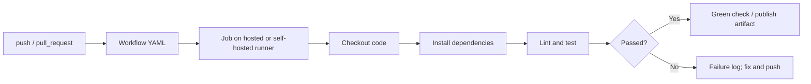

# 10 — GitHub Advanced Features

**Previous:** [09 — Collaboration workflows](../09-collaboration-workflows/README.md) · **Home:** [Course home](../README.md) · **Next:** [11 — Best practices](../11-best-practices/README.md)

## GitHub Actions: automate work

GitHub Actions runs workflows in response to events such as pushes, pull requests, schedules, or manual dispatch. A workflow is YAML in `.github/workflows/`; jobs run on runners and contain steps that use shell commands or actions.

**Analogy:** a workflow is an automated workshop checklist: an event opens a job ticket, a runner follows steps, and checks report whether the change is ready.



### Minimal CI workflow

```yaml
name: Markdown links
on:
  push:
    branches: [main]
  pull_request:
    branches: [main]
permissions:
  contents: read
jobs:
  links:
    runs-on: ubuntu-latest
    steps:
      - uses: actions/checkout@v4
      - name: Check local Markdown links
        uses: lycheeverse/lychee-action@v2
        with:
          args: --offline --include-fragments './**/*.md'
```

This checks local links and fragments without relying on external-site availability. Pin actions according to your organization's supply-chain policy; major-version tags are convenient but can move. Give workflows the minimum `permissions` they need.

| GitHub CLI command | Purpose |
|---|---|
| `gh workflow list` | List configured workflows |
| `gh run list` | Inspect recent workflow runs |
| `gh run view RUN_ID --log` | Read a run's logs |
| `gh secret list` | List secret names available in the current scope (values are not shown) |

After a push, `gh run list` shows run IDs, workflow names, branches, status, and event. Install and authenticate the GitHub CLI separately; these are optional conveniences, not Git commands.

## Pages, protections, and ownership

| Feature | What it does | Good practice |
|---|---|---|
| GitHub Pages | Hosts static sites from a repository or workflow | Publish only intended public content; document build source |
| Branch protection / rulesets | Require checks, reviews, signed commits, or restrict pushes | Protect default/release branches; keep bypass list small |
| CODEOWNERS | Requests review from responsible owners for matching paths | Place `.github/CODEOWNERS`; patterns are path-based and order matters |
| Dependabot | Opens dependency/security update PRs | Review changes and CI; configure update cadence and ecosystems |
| Repository secrets | Makes encrypted values available to authorized workflows | Never print secrets; scope by environment and job |
| Packages | Stores and distributes build/container packages | Set visibility, permissions, retention, and provenance appropriately |

## Secrets and workflow security

Use GitHub Actions secrets via `${{ secrets.SECRET_NAME }}` only where required. Prefer short-lived OIDC credentials over long-lived cloud keys when supported. Fork-originated pull requests have restricted secret access by default; do not weaken controls to make untrusted code run with privileged credentials. Treat action dependencies and self-hosted runners as code execution surfaces.

```yaml
permissions:
  contents: read
```

Start with minimal token permissions. Avoid `pull_request_target` for workflows that check out or execute untrusted PR code with elevated permissions. Never echo secret values into logs.

## Walkthrough: protect the main branch

1. Open repository **Settings → Rules → Rulesets** (or branch protection settings).
2. Target the default branch.
3. Require pull requests and at least one review appropriate to team size.
4. Require relevant CI checks and resolve conversations before merging.
5. Restrict force pushes/deletions; avoid broad bypass permissions.
6. Open a test PR and confirm the rules behave as expected.

## Common pitfalls and pro tips

- YAML indentation and event names are significant; validate workflow syntax before relying on it.
- A green CI result only covers configured checks. Keep tests representative.
- Fork PRs should be considered untrusted input; avoid running privileged commands on their code.
- Protect production deployment environments and require approvals where appropriate.
- Review `GITHUB_TOKEN` permissions and third-party actions regularly.

> [!WARNING]
> A workflow can execute arbitrary code from the repository. Treat PR code, actions, dependencies, artifacts, and runner credentials as part of your security boundary.

## Quick recap

- Actions turns events into runner jobs; define small, least-privilege workflows.
- Pages hosts static sites; rules protect branches; CODEOWNERS routes review.
- Secrets need minimal scope, and automation must be designed for untrusted contributions.

**Previous:** [09 — Collaboration workflows](../09-collaboration-workflows/README.md) · **Home:** [Course home](../README.md) · **Next:** [11 — Best practices](../11-best-practices/README.md)
