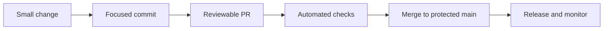

# 11 — Git & GitHub Best Practices

**Previous:** [10 — GitHub advanced](../10-github-advanced/README.md) · **Home:** [Course home](../README.md) · **Next:** [12 — Troubleshooting](../12-troubleshooting/README.md)

## Build a history people can use

Good Git practice makes changes reviewable, recoverable, and safe to share. Aim for commits that explain one coherent change, branches that live briefly, and a main line that stays tested.

**Analogy:** a useful commit history is a well-kept lab notebook: each entry is dated, specific, and small enough that another person can understand the experiment.



## Commit messages

Use an imperative summary describing the change: `Add search filter`, not `Added stuff`. A common format is:

```text
type(scope): imperative summary

Optional explanation of context and trade-offs.
```

Conventional Commits commonly use `feat`, `fix`, `docs`, `style`, `refactor`, `perf`, `test`, `build`, `ci`, and `chore`. Example: `fix(parser): reject empty input`. A `!` or `BREAKING CHANGE:` footer conventionally indicates a breaking change when the project uses that convention. Agree on rules; do not force a template where plain clear messages work better.

| Command | Helpful options |
|---|---|
| `git status` | `-sb` concise branch and state |
| `git diff` | `--check` whitespace checks; `--stat` summary |
| `git add` | `-p` stage only selected hunks |
| `git commit` | `-m` message; `--amend` replace latest commit (rewrites ID) |
| `git push` | `-u` set upstream; `--force-with-lease` only for coordinated rewrites |

## Branching, security, and monorepos

| Area | Recommended practice |
|---|---|
| Branches | Short-lived, descriptive names such as `fix/login-timeout`; delete merged branches |
| Reviews | Small PRs with context, linked issue, and verification details |
| Security | Never commit secrets; use secret managers, least privilege, dependency scanning, and rotation |
| Releases | Tag deliberately; document changes and compatibility; automate repeatable builds |
| Monorepos | Define ownership, dependency boundaries, affected-test selection, and consistent tooling |
| Large files | Use Git LFS or artifact storage when appropriate; avoid binary churn in ordinary Git history |

### Walkthrough: a safe feature routine

1. Update your base: `git switch main; git pull --ff-only`.
2. Create a focused branch: `git switch -c feat/search-filter`.
3. Make a small change, run relevant tests, and inspect `git diff`.
4. Commit with a specific message; avoid unrelated formatting changes.
5. Push and open a PR with purpose, test evidence, and risks.
6. Address feedback, ensure checks pass, merge per team policy, and delete the branch.

```console
$ git status -sb
## feat/search-filter
$ git diff --check
# (no output means no whitespace errors)
$ git log -1 --oneline
4a1b2c3 (HEAD -> feat/search-filter) feat(search): add filter
```

The commit ID varies. Clean formatting output does not replace tests or review; it is one check in the routine.

## Common pitfalls and pro tips

- Do not commit `.env`, private keys, access tokens, or customer data. If exposed, revoke/rotate immediately and follow incident procedures.
- `.gitignore` is not a security boundary: it only hides untracked files from normal status display.
- Avoid `git push --force` on shared branches. If authorized, use `--force-with-lease` and notify collaborators.
- Avoid giant “cleanup” commits mixed with feature behavior; review becomes difficult.
- For monorepos, make ownership and dependency impact visible rather than relying on tribal knowledge.

> [!TIP]
> Ask of each commit: can a reviewer explain what changed, why, and how to verify it without reading unrelated changes?

## Quick recap

- Write focused commits and PRs; automate checks and protect important branches.
- Treat all secrets as compromised if committed or logged; rotate immediately.
- Choose conventions that make work easier for the people maintaining the repository.

**Previous:** [10 — GitHub advanced](../10-github-advanced/README.md) · **Home:** [Course home](../README.md) · **Next:** [12 — Troubleshooting](../12-troubleshooting/README.md)
