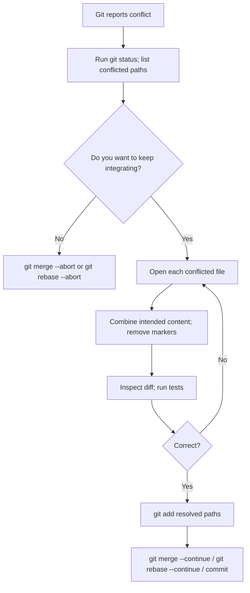

# 12 — Troubleshooting and Recovery

**Previous:** [11 — Best practices](../11-best-practices/README.md) · **Home:** [Course home](../README.md) · **Next:** [13 — Cheatsheets](../13-cheatsheets/README.md)

## Diagnose before changing anything

Most Git problems become manageable when you identify repository state before acting. Run `git status`, inspect recent history, and read the complete error message. Prefer an inspection command before a modifying command.

**Analogy:** troubleshooting is tracing a route on a map before turning around. `status` tells you where you are; `log` and `reflog` show how you got there.

## Merge-conflict decision flow



## Common error table

| Symptom | Likely cause | Safe next step |
|---|---|---|
| `not a git repository` | Current directory is outside repository | `pwd`/`Get-Location`, `ls`/`Get-ChildItem`, enter correct folder |
| `Author identity unknown` | Name/email not configured | Set `git config user.name` and `user.email` |
| `Permission denied (publickey)` | SSH key missing/not loaded/wrong URL | Check `ssh -T git@github.com`, agent, and `git remote -v` |
| `rejected ... non-fast-forward` | Remote has commits your branch lacks | `git fetch`, inspect, integrate, push again |
| `detached HEAD` | Checked out a commit/tag, not a branch | Create a branch with `git switch -c rescue/name` if work must be kept |
| conflict markers remain | File not fully resolved | Search for `<<<<<<<`, resolve, stage, test |
| `pathspec ... did not match` | Path/name/branch is incorrect | Use `git status --short`, quote paths, check case and spelling |

## Detached HEAD and lost commits

Detached HEAD means `HEAD` points directly to a commit rather than a branch. It is safe for inspection. If you create commits and want to keep them, run `git switch -c save/my-work` before switching elsewhere.

To recover a recent commit that a reset/branch deletion made hard to find:

```bash
git reflog --date=local
git show HASH
git branch rescue/recovered-work HASH
```

Verify the rescue branch before resetting or deleting anything. Reflogs are local and expire; a commit pushed to another trusted remote may also be recoverable there.

## Force-push danger

A force push replaces a remote branch pointer and can hide commits from collaborators. First fetch and inspect. If rewriting a branch is explicitly agreed, `git push --force-with-lease origin BRANCH` is safer than `--force` because it checks that the remote still matches the state you observed. It is still a history rewrite and can discard work if used carelessly.

## Walkthrough: rejected push

1. Stop; do not force push.
2. Run `git status -sb` and `git fetch origin`.
3. Inspect `git log --oneline --graph --decorate --all -15`.
4. Integrate the remote branch using the team's merge/rebase policy.
5. Resolve conflicts, test, then push again.

Typical rejection text includes `! [rejected] ... (non-fast-forward)`. Fetching and inspecting the graph shows whether the remote has commits you do not yet have; exact output depends on the server and branch names.

## Pro tips

- Copy important uncommitted edits before experimenting with destructive resets.
- `git status` gives context; `git diff` and `git show` reveal content.
- For an unfamiliar command, consult `git help COMMAND` before running it.
- Do not paste private URLs, credentials, or personal data when asking for help.

> [!WARNING]
> `reset --hard`, `clean -fd`, and force pushes can destroy or hide work. Preview, back up, and understand the target first.

## Quick recap

- Diagnose with status/log before modifying history.
- Abort an in-progress merge/rebase if you need to return to its starting point.
- Reflog often recovers recent local ref movements; rescue useful commits with a branch.

**Previous:** [11 — Best practices](../11-best-practices/README.md) · **Home:** [Course home](../README.md) · **Next:** [13 — Cheatsheets](../13-cheatsheets/README.md)
