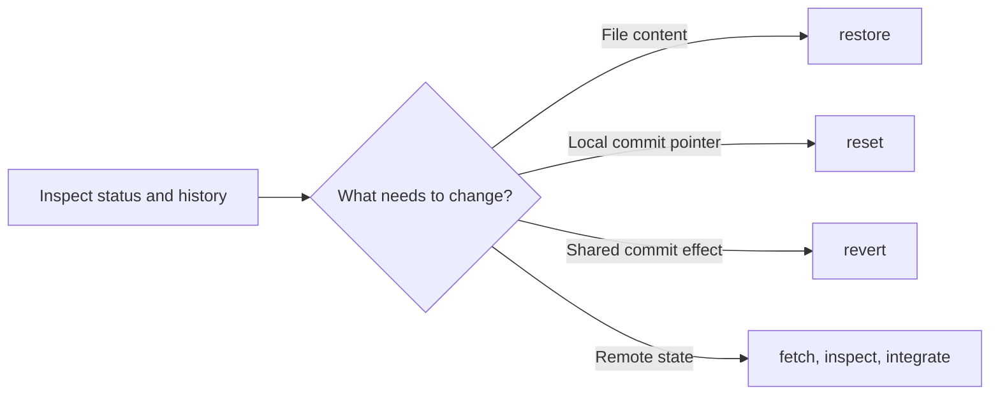

# 13 — Git Cheatsheets

**Previous:** [12 — Troubleshooting](../12-troubleshooting/README.md) · **Home:** [Course home](../README.md) · **Next:** [14 — Practice](../14-practice/README.md)

## How to use a cheat sheet

A cheat sheet is a field map, not autopilot: identify the state first, then choose a command whose effect matches the outcome you want.

**Analogy:** a pilot checks instruments before changing course; Git users check status and history before changing files or refs.



## One-page command reference

Print this section in landscape or save it as a quick-reference page.

| Task | Commands |
|---|---|
| Start / copy | `git init -b main` · `git clone URL` |
| Inspect state | `git status -sb` · `git log --oneline --graph --decorate --all` · `git show COMMIT` |
| Compare | `git diff` · `git diff --staged` · `git diff A..B` |
| Stage / commit | `git add PATH` · `git add -p` · `git commit -m "message"` |
| Branch | `git switch -c NAME` · `git switch NAME` · `git branch -vv` |
| Integrate | `git merge BRANCH` · `git rebase BASE` · `git cherry-pick HASH` |
| Remote | `git remote -v` · `git fetch --prune` · `git pull --ff-only` · `git push -u origin BRANCH` |
| Undo file edits | `git restore PATH` · `git restore --staged PATH` |
| Undo commits | `git revert HASH` (shared) · `git reset --soft HEAD~1` (private) |
| Save temporary edits | `git stash push -u -m "message"` · `git stash list` · `git stash pop` |
| Recover / debug | `git reflog` · `git cat-file -p HEAD` · `git check-ignore -v PATH` |

## Situation → command lookup

| Situation | Start with |
|---|---|
| I want to see changed files | `git status` |
| I want to inspect unstaged edits | `git diff` |
| I want to inspect what will be committed | `git diff --staged` |
| I staged the wrong file | `git restore --staged PATH` |
| I want to discard a file edit | `git restore PATH` (after verifying it is safe) |
| I committed to the wrong branch, not yet shared | Create intended branch at commit, then reset old branch carefully; see walkthrough below |
| I committed a mistake already shared | `git revert HASH` |
| I need the latest remote info without integrating | `git fetch` |
| My push was rejected | `git fetch`, inspect graph, integrate; do not immediately force push |
| I lost a local commit | `git reflog`, then `git branch rescue/name HASH` |
| I need a clean pull with no merge commit | `git pull --ff-only` (fails safely if not fast-forwardable) |
| I want to pause uncommitted work | `git stash push -u` |

### Committed on the wrong branch (private commit)

If the commit is `HEAD` and not pushed, preserve it on a new branch first:

```bash
git branch feature/correct-place HEAD
git switch main
git reset --hard HEAD~1
git switch feature/correct-place
```

This assumes `main` is the wrong branch, the mistaken commit is its latest commit, and there are no other changes to preserve. **Only run the hard reset after confirming `feature/correct-place` points to the commit and the current branch is the intended branch to reset.** If other commits/changes are involved, inspect the graph and choose a safer sequence; if already pushed, use `revert` or coordinate a rewrite.

## Useful navigation and inspection

```bash
git status -sb
git log --oneline --graph --decorate --all
git branch -avv
git remote -v
git show --stat HEAD
git diff --check
```

Typical clean status output is `## main`; an empty `git diff --check` output means Git found no whitespace errors in the checked diff.

## Quick recap

- Inspect before modifying: status, log, diff.
- Use restore for files, reset for private pointer/index movement, revert for shared history.
- Force operations are exceptional; preserve work and understand the target first.

**Previous:** [12 — Troubleshooting](../12-troubleshooting/README.md) · **Home:** [Course home](../README.md) · **Next:** [14 — Practice](../14-practice/README.md)
