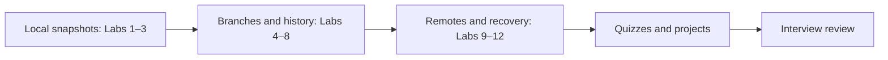

# 14 — Practice, Quizzes, and Interview Questions

**Previous:** [13 — Cheatsheets](../13-cheatsheets/README.md) · **Home:** [Course home](../README.md) · **Next:** [Course home](../README.md)

## How to practice

Use temporary repositories and type each command rather than copying blindly. Each lab lists an objective, steps, expected result, and a collapsible solution. Replace example names/emails. Never practice destructive commands in a repository containing important work.

Treat each lab as an independent exercise in a fresh disposable directory. Labs 2–4 and 7–12 assume the baseline below; Lab 1 initializes its own repository, and Labs 5–6 create their own branch scenarios on top of this baseline. Configure `user.name` and `user.email` first if Git has not been configured.

```bash
mkdir git-lab && cd git-lab
git init -b main
git config user.name "Practice Learner"
git config user.email "learner@example.com"
echo "Base" > notes.md
git add notes.md
git commit -m "docs: create practice baseline"
```

For the next lab, start in a new empty directory and repeat this setup. Do not reuse a repository when a lab intentionally resets or rewrites history.

**Analogy:** Git practice is like learning a musical instrument—short, deliberate exercises build muscle memory; the solution is a tuning reference, not a substitute for trying.



| Command | Useful option in the labs |
|---|---|
| `git status` | `-sb` show branch and compact state |
| `git diff` | `--staged` inspect the next snapshot |
| `git log` | `--oneline --graph --all` see a compact commit graph |
| `git push` | `-u` set the branch's upstream on first push |
| `git reset` | `--hard` is destructive; use only in the disposable recovery lab |

## Hands-on labs

### Lab 1 — Initialize and commit

**Objective:** create a repository and first snapshot. **Steps:** initialize `lab-one`, add `notes.md`, stage, commit, inspect status/log. **Expected:** one root commit and a clean tree.

<details><summary>Solution</summary>

```bash
mkdir lab-one && cd lab-one
git init -b main
echo "First note" > notes.md
git add notes.md
git commit -m "docs: add first note"
git status -sb
git log --oneline
```

</details>

### Lab 2 — Stage selectively

**Objective:** commit one of two edited files. **Steps:** create and commit `a.txt`, `b.txt`; edit both; stage only `a.txt`; inspect staged and unstaged diffs; commit. **Expected:** `a.txt` is committed, `b.txt` remains modified.

<details><summary>Solution</summary>

```bash
echo "one" > a.txt
echo "one" > b.txt
git add a.txt b.txt
git commit -m "docs: add starter files"
echo "two" >> a.txt
echo "two" >> b.txt
git add a.txt
git diff --staged
git diff
git commit -m "docs: update a"
git status --short
```

</details>

### Lab 3 — Ignore build output

**Objective:** ignore generated files. **Steps:** create `dist/output.js`; add `dist/` to `.gitignore`; inspect status and `git check-ignore -v`. **Expected:** output is ignored, `.gitignore` is untracked/stageable.

<details><summary>Solution</summary>

```bash
mkdir dist
echo "generated" > dist/output.js
echo "dist/" > .gitignore
git check-ignore -v dist/output.js
git status --short
```

</details>

### Lab 4 — Branch and fast-forward

**Objective:** create a feature branch and merge it. **Steps:** create `feature/intro`, add one commit, switch back to `main`, merge. **Expected:** history is linear and merge fast-forwards.

<details><summary>Solution</summary>

```bash
git switch -c feature/intro
echo "Intro" >> README.md
git add README.md
git commit -m "docs: add intro"
git switch main
git merge feature/intro
git log --oneline --graph --all
```

</details>

### Lab 5 — Resolve a merge conflict

**Objective:** resolve overlapping edits. **Steps:** edit the same line on two branches, commit each, merge, edit markers to intended final content, stage and finish. **Expected:** no markers, both branch histories integrated.

<details><summary>Solution outline</summary>

```bash
git switch -c feature/conflict
echo "Feature heading" > notes.md
git add notes.md
git commit -m "docs: edit heading on feature"
git switch main
echo "Main heading" > notes.md
git add notes.md
git commit -m "docs: edit heading on main"
git merge feature/conflict
git status --short
# Edit the conflicted file; remove <<<<<<<, =======, >>>>>>>
git add notes.md
git commit -m "merge: resolve heading conflict"
git status -sb
```

</details>

### Lab 6 — Rebase a feature branch

**Objective:** replay a private feature commit on an advanced base. **Steps:** make a feature commit, make a separate base commit, rebase feature onto base. **Expected:** feature commit has a new hash and sits after base commit.

<details><summary>Solution</summary>

```bash
git switch -c feature/example
echo "Feature work" > feature.txt
git add feature.txt
git commit -m "docs: add feature note"
git switch main
echo "Base update" > base.txt
git add base.txt
git commit -m "docs: update base"
git switch feature/example
git rebase main
git log --oneline --graph --all
```

</details>

### Lab 7 — Unstage and restore

**Objective:** distinguish staging from working edits. **Steps:** modify and stage a file, unstage it, then discard only after confirming. **Expected:** first working change remains; final file matches `HEAD`.

<details><summary>Solution</summary>

```bash
echo "temporary edit" >> notes.md
git add notes.md
git restore --staged notes.md
git diff -- notes.md
# Only if you intend to discard this content:
git restore notes.md
git status --short
```

</details>

### Lab 8 — Revert a commit

**Objective:** undo a committed change without rewriting history. **Steps:** make a commit, then revert it. **Expected:** a new commit reverses the change.

<details><summary>Solution</summary>

```bash
echo "mistake" > mistake.txt
git add mistake.txt
git commit -m "docs: add mistaken note"
git revert --no-edit HEAD
git log --oneline -3
```

</details>

### Lab 9 — Remote tracking

**Objective:** publish and track a branch. **Steps:** create an empty remote repository; add as `origin`; push with `-u`; inspect branch tracking. **Expected:** local branch tracks `origin/BRANCH`.

<details><summary>Solution</summary>

```bash
git remote add origin URL
git push -u origin main
git branch -vv
git fetch --prune
```

</details>

### Lab 10 — Recover with reflog

**Objective:** find a recently moved commit. **Steps:** create a commit, move branch back one commit, locate original via reflog, create rescue branch. **Expected:** commit is reachable from rescue branch.

> [!WARNING]
> This lab intentionally uses `reset --hard`. Run it only in the disposable lab repository created for this exercise.

<details><summary>Solution</summary>

```bash
echo "recover me" > recover.txt
git add recover.txt
git commit -m "docs: add recoverable note"
git reset --hard HEAD~1
git reflog
git branch rescue/recovered HASH
git log rescue/recovered --oneline
```

</details>

### Lab 11 — Cherry-pick a fix

**Objective:** apply one commit to a second branch. **Steps:** create a fix commit on one branch; switch to another; cherry-pick its hash. **Expected:** same change appears as a new commit.

<details><summary>Solution</summary>

```bash
git switch -c release/example
git switch -c fix/one-line
echo "Fix" >> notes.txt
git add notes.txt
git commit -m "fix: correct note"
git rev-parse HEAD
git switch release/example
git cherry-pick HASH
git show --stat HEAD
```

Use the ID printed by `git rev-parse HEAD` in place of `HASH`.

</details>

### Lab 12 — Create and publish a release tag

**Objective:** mark a release. **Steps:** create an annotated tag, inspect it, push tag. **Expected:** remote lists tag; a GitHub Release can then be created from it.

<details><summary>Solution</summary>

```bash
git remote add origin URL
git tag -a v0.1.0 -m "First practice release"
git show v0.1.0
git push origin v0.1.0
```

Replace `URL` with the URL of an empty hosted repository. If you already configured `origin` in this lab repository, skip the first command.

</details>

## Quizzes

### Foundations and basics

1. Which command stages a selected file? A) `git commit` B) `git add` C) `git push`
2. Which is a distributed VCS? A) Git B) GitHub C) Pages
3. Does `.gitignore` untrack a committed file? A) Yes B) No

### Branches and history

4. What does a fast-forward merge move? A) A branch pointer B) Every blob C) Remote URL
5. Does rebase preserve original commit IDs? A) Yes B) No
6. Which operation is generally safe for shared history? A) `reset --hard` B) `revert` C) amend published commit

### Remotes and collaboration

7. Does `fetch` integrate changes into current branch? A) Yes B) No
8. What is a fork? A) Hosted copy B) Local branch C) Tag
9. What does a PR primarily propose? A) Branch integration B) Package install C) SSH authentication

### Internals, security, and recovery

10. What does a tree describe? A) Directory entries B) User password C) Workflow runner
11. Where can recent local `HEAD` movements be inspected? A) `reflog` B) `.gitignore` C) `remote -v`
12. What should happen first after a secret is published? A) Rotate/revoke it B) Delete one file only C) Rename branch

**Answer key:** 1-B, 2-A, 3-B, 4-A, 5-B, 6-B, 7-B, 8-A, 9-A, 10-A, 11-A, 12-A.

### Short-answer prompts

1. Explain working tree vs index vs repository.
2. When is rebase appropriate, and when can it harm collaboration?
3. Compare `reset`, `restore`, and `revert`.
4. Why is `--force-with-lease` safer than `--force`, yet still risky?
5. How do you respond to a committed credential?

<details><summary>Answer guidance</summary>

1. Working tree is editable files; index is selected next snapshot; repository holds commits/objects.
2. Rebase a private branch for a clean base; avoid rewriting shared commits without coordination.
3. Reset moves a branch and optionally resets index/files; restore changes selected file/index state; revert adds an inverse commit.
4. Lease checks the observed remote ref but still replaces history if the check passes.
5. Revoke/rotate immediately, assess exposure, then remove from history if appropriate and notify affected parties.

</details>

## Mini projects

### Project A — Conflict-resilient documentation repository

Create a small multi-file guide with two feature branches that edit overlapping sections. Practice merge conflict resolution, document a merge policy, add tests or link checks, and submit a reviewable PR. **Done when:** history is understandable, conflict markers are absent, and checks pass.

### Project B — Open-source contribution simulation

Fork a small public project, clone the fork, add upstream, find a documentation improvement, branch, commit, push, and open a PR. Follow its contribution guide and respond to review feedback. **Done when:** the PR explains motivation, scope, and verification. Do not make low-quality drive-by changes to real projects; use a practice repository if needed.

### Project C — Continuous integration pipeline

Create a tiny program or documentation repository and add an Actions workflow for tests/lint. Require the check on pull requests, deliberately introduce a failing change, inspect logs, repair it, and confirm green status. **Done when:** the default branch is protected by a required relevant check.

## Interview questions (concise answers)

1. **What is Git?** A distributed version-control system that stores content-addressed history.
2. **Git vs GitHub?** Git is the tool; GitHub hosts Git repositories and collaboration features.
3. **What is a repository?** A working tree plus Git metadata/history.
4. **What is a commit?** A snapshot tree, metadata, and parent references.
5. **What is a blob?** A Git object containing file bytes.
6. **What is a tree?** An object mapping names/modes to blobs or subtrees.
7. **What is `HEAD`?** The current checkout reference, usually a symbolic branch ref.
8. **What is the index?** The staging structure describing the next commit's tree.
9. **What does `git add` do?** Copies selected current content into the index.
10. **What is a branch?** A movable ref to a commit.
11. **What is a fast-forward?** Moving a branch ref forward when no divergence exists.
12. **What is a three-way merge?** Combining two tips using their common ancestor.
13. **Merge vs rebase?** Merge preserves divergent histories; rebase replays commits with new IDs.
14. **What is a conflict?** Git cannot automatically combine competing changes.
15. **How do you resolve a conflict?** Edit intended result, remove markers, stage, test, continue integration.
16. **What is cherry-pick?** Apply a chosen commit's change onto current branch as a new commit.
17. **What is amend?** Replace the latest commit, changing its ID.
18. **What is reflog?** A local log of recent ref/HEAD movements.
19. **What is reset?** Move current branch and optionally update index/working tree.
20. **What is revert?** Add a commit that inverses another commit's change.
21. **What is restore?** Restore file or index content from a source.
22. **Reset vs revert?** Reset rewrites a branch pointer; revert preserves history with an inverse commit.
23. **What does `--soft` keep?** Index and working tree after moving branch pointer.
24. **What does `--mixed` do?** Resets index to target but leaves working files.
25. **Why is `--hard` dangerous?** It overwrites tracked working files and discards local state.
26. **What is stash?** Temporary storage for work not yet committed.
27. **What does fetch do?** Download objects and update remote-tracking refs without integrating.
28. **What does pull do?** Fetch then integrate (merge or rebase).
29. **What does push do?** Publish commits/refs to a remote.
30. **What is upstream tracking?** Association between local branch and its remote branch.
31. **What is a remote-tracking branch?** Local record of a remote branch's last fetched state.
32. **Fork vs clone?** Fork is hosted copy; clone is a local repository copy.
33. **What is a pull request?** A host-based proposal to review and integrate branch changes.
34. **What is Gitflow?** A branch model with main/develop and release/feature/hotfix branches.
35. **What is trunk-based development?** Frequent integration of small changes to the main trunk.
36. **What is a tag?** A name marking an object, often a release commit.
37. **Annotated vs lightweight tag?** Annotated has tag metadata/message/signature; lightweight is a direct ref.
38. **How should a leaked secret be handled?** Revoke/rotate immediately, assess impact, then clean history as needed.
39. **What is CI?** Automated build/test/checks on changes.
40. **How do you recover a recent lost commit?** Find it in `git reflog`, inspect, and create a rescue branch.
41. **Why protect the default branch?** To require review/checks and prevent unsafe direct changes.
42. **What is CODEOWNERS?** A path-to-reviewer mapping used to request ownership review.
43. **When use Git LFS?** For large binaries that should be stored via LFS pointers rather than ordinary Git blobs.
44. **What is a shallow clone?** A clone with limited commit history, often used to reduce CI download time.
45. **What does `git clean -fd` do?** Deletes untracked files and directories; preview with `git clean -nd` first.

## Quick recap

- Practice in disposable repositories and verify state after every operation.
- Labs progress from first commit to collaboration, release tagging, and recovery.
- Use the answer sections to identify concepts that need another pass.

**Previous:** [13 — Cheatsheets](../13-cheatsheets/README.md) · **Home:** [Course home](../README.md) · **Next:** [Course home](../README.md)
