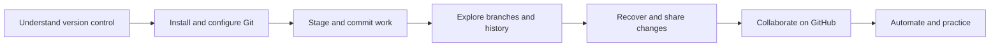

<div align="center">

# Git & GitHub Course

### Learn version control by doing: from your first commit to confident collaboration.

[](LICENSE)
[](https://rdrahul123.github.io/Git-and-GitHub/)
[](https://github.com/RDrahul123/Git-and-GitHub/actions/workflows/markdown-links.yml)
[](CONTRIBUTING.md)
[](https://github.com/RDrahul123/Git-and-GitHub/stargazers)

<br>

**[Open the interactive course →](https://rdrahul123.github.io/Git-and-GitHub/)**

<sub>15 focused modules · 12 hands-on labs · 3 mini projects · 45 interview questions</sub>

</div>

---

## Start learning

No prior Git experience needed. This free, self-paced course takes you from the basic mental model to real-world teamwork, troubleshooting, and GitHub automation.

| I want to… | Start here |
|---|---|
| Learn Git from the beginning | [00 — Introduction](00-introduction/README.md) |
| Make my first commit | [02 — Git basics](02-git-basics/README.md) |
| Understand branches and conflicts | [04 — Branching & merging](04-branching-merging/README.md) |
| Undo a change safely | [06 — Undoing changes](06-undoing-changes/README.md) |
| Contribute through a pull request | [08 — GitHub essentials](08-github-essentials/README.md) |
| Look up a command quickly | [13 — Cheatsheets](13-cheatsheets/README.md) |
| Practice what I’ve learned | [14 — Labs & interview questions](14-practice/README.md) |

## Your learning path



## Course contents

| Part | Modules |
|---|---|
| **01 · Foundations** | [00 Introduction](00-introduction/README.md) · [01 Installation & setup](01-installation-setup/README.md) |
| **02 · Everyday Git** | [02 Git basics](02-git-basics/README.md) · [03 Git internals](03-git-internals/README.md) |
| **03 · History & recovery** | [04 Branching & merging](04-branching-merging/README.md) · [05 Rebase & history](05-rebase-and-history/README.md) · [06 Undoing changes](06-undoing-changes/README.md) |
| **04 · Sharing & teamwork** | [07 Remote repositories](07-remote-repositories/README.md) · [08 GitHub essentials](08-github-essentials/README.md) · [09 Collaboration workflows](09-collaboration-workflows/README.md) |
| **05 · Shipping well** | [10 GitHub advanced](10-github-advanced/README.md) · [11 Best practices](11-best-practices/README.md) · [12 Troubleshooting](12-troubleshooting/README.md) |
| **06 · Reference & practice** | [13 Cheatsheets](13-cheatsheets/README.md) · [14 Practice](14-practice/README.md) |

## What makes this course useful

- **Understand the why:** plain-language explanations followed by technical detail about Git’s objects, refs, and history.
- **See the change:** Mermaid diagrams make branches, merges, rebases, workflows, and recovery easier to picture.
- **Practice safely:** annotated commands, realistic scenarios, 12 guided labs, quizzes, and collapsible solutions.
- **Collaborate confidently:** forks, pull requests, reviews, GitHub Actions, security, and team workflows.
- **Keep it close:** printable references, situation-to-command lookups, and concise interview answers.

> [!TIP]
> The best way to learn Git is to run the commands. Use a **disposable practice repository** and check `git status` before changing history.

## How to use the course

1. Follow the modules in order, or jump in from the table above.
2. Type examples in a temporary repository and adapt names and paths to your environment.
3. Attempt each lab before expanding its solution.
4. Use the [undo decision guide](06-undoing-changes/README.md) and [troubleshooting notes](12-troubleshooting/README.md) when you get stuck.

### Run the interactive course locally

```bash
python -m http.server 8000
```

Open [http://localhost:8000](http://localhost:8000). Run the command from the repository root; the browser fetches lesson Markdown and rendering libraries, so opening `index.html` directly as a file will not work.

## Contribute

Found a typo, unclear explanation, or command that needs correction? Contributions are welcome. See the [contribution guide](CONTRIBUTING.md), open an [issue](https://github.com/RDrahul123/Git-and-GitHub/issues), or submit a pull request.

## License & credits

Course content is shared under the [MIT License](LICENSE). Git command behavior is based on the official Git documentation; GitHub feature descriptions follow GitHub Docs.

<div align="center">

**Ready? Start with [00 — Introduction](00-introduction/README.md) or [open the interactive course](https://rdrahul123.github.io/Git-and-GitHub/).**

</div>
