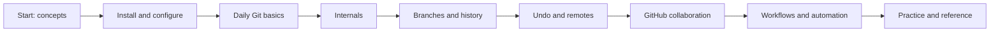

# Git & GitHub Notes

**A practical, from-zero-to-confident course for version control and collaboration.**

[](LICENSE)
[](CONTRIBUTING.md)
[](https://github.com/OWNER/REPO/stargazers)

> Replace `OWNER/REPO` in the stars badge with the published repository path.

This repository is a standalone learning path for Git (the version-control tool) and GitHub (a hosted collaboration platform). Start with the mental model, practice each command in a disposable repository, then use the workflow and troubleshooting sections as references.

**Course website landing page:** [index.md](index.md) (useful when publishing with GitHub Pages).

## What you will learn

- Track work safely with commits, branches, and remotes.
- Understand the index, object database, refs, `HEAD`, and commit hashes.
- Select merge, rebase, reset, restore, or revert without guessing.
- Collaborate through forks, pull requests, issues, reviews, and CI.
- Recover from common mistakes and adopt sustainable team practices.

## Learning roadmap



## Table of contents

| Stage | Module |
|---|---|
| Foundations | [00 — Introduction](00-introduction/README.md) · [01 — Installation & setup](01-installation-setup/README.md) |
| Local Git | [02 — Git basics](02-git-basics/README.md) · [03 — Git internals](03-git-internals/README.md) |
| History | [04 — Branching & merging](04-branching-merging/README.md) · [05 — Rebase & history](05-rebase-and-history/README.md) · [06 — Undoing changes](06-undoing-changes/README.md) |
| Sharing | [07 — Remote repositories](07-remote-repositories/README.md) · [08 — GitHub essentials](08-github-essentials/README.md) |
| Team practice | [09 — Collaboration workflows](09-collaboration-workflows/README.md) · [10 — GitHub advanced](10-github-advanced/README.md) · [11 — Best practices](11-best-practices/README.md) |
| Reference & practice | [12 — Troubleshooting](12-troubleshooting/README.md) · [13 — Cheatsheets](13-cheatsheets/README.md) · [14 — Practice](14-practice/README.md) |

## Prerequisites

No Git experience is required. You need a terminal (PowerShell, Terminal, or a shell), a text editor, and optionally a free GitHub account for hosted collaboration. Examples use portable Git commands; adapt paths to your shell.

## How to use this course

1. Read in numeric order; each module links to the previous and next module.
2. Type commands yourself in a temporary folder. Replace example names and email addresses with your own.
3. Pay attention to warnings before destructive commands. Run `git status` before changing history.
4. Complete the labs in [14 — Practice](14-practice/README.md); open solutions only after attempting a lab.
5. Return to the [cheatsheets](13-cheatsheets/README.md) and [troubleshooting guide](12-troubleshooting/README.md) during real work.

## Publish this repository

Create an empty repository on GitHub (do not initialize it with a README if you already have one locally), then from this directory:

```bash
git init -b main
git add .
git commit -m "docs: publish Git and GitHub learning notes"
git remote add origin https://github.com/OWNER/git-github-notes.git
git push -u origin main
```

Replace `OWNER` with your account or organization. To publish as a website, open **Settings → Pages**, select **Deploy from a branch**, choose `main` and `/ (root)`, and save. The included [`index.md`](index.md) becomes the Pages landing page; a dedicated static-site generator can provide more polished navigation if desired.

### Publishing checklist

- [ ] Create a public GitHub repository named `git-github-notes`.
- [ ] Replace `OWNER/REPO` in the stars badge with the final owner and repository.
- [ ] Push `main` and confirm the Actions link-check workflow passes.
- [ ] Review the rendered landing page, Mermaid diagrams, and relative navigation links.
- [ ] Optionally enable GitHub Pages using the instructions above.
- [ ] Add the description and topics below in repository **About** settings.

**Suggested repository description:** `A practical, beginner-to-advanced open course on Git and GitHub, with diagrams, command examples, troubleshooting, and hands-on labs.`

**Suggested topics:** `git`, `github`, `version-control`, `git-tutorial`, `learning-resources`, `mermaid`, `documentation`, `open-source`

**About blurb:** Learn Git from first commit through advanced history, collaboration, recovery, and GitHub automation—entirely from focused Markdown notes and practical exercises.

## Contribute

Found an error or want to improve an explanation? Read [CONTRIBUTING.md](CONTRIBUTING.md), open an issue, or submit a pull request. Small corrections are welcome.

## Author & credits

Written as an open learning resource for students and working developers. Git command behavior follows the official Git documentation; GitHub-specific features follow GitHub Docs. See [CONTRIBUTING.md](CONTRIBUTING.md) for the editing approach and license details.

---

**Next:** [00 — Introduction](00-introduction/README.md)
